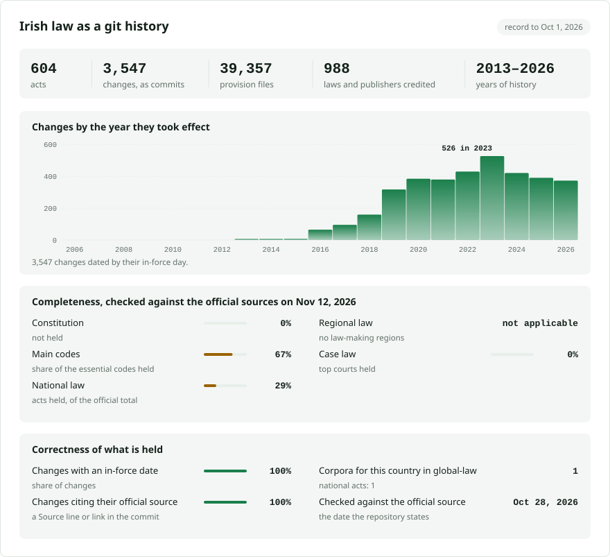

# Ireland: law history in git

<picture>
<source media="(prefers-color-scheme: dark)" srcset="data/effort-dark.svg">

</picture>

The law of Ireland as a git history: one file per section, one commit per change on the day it took effect, and the law that made each change as the commit's author. `git blame` names the law behind every paragraph; `git log` lists every change to a section; picking a date gives the text in force that day.

Part of [lexifina/global-law](https://github.com/lexifina/global-law), one git history for every country's law: this is Ireland's national law, which global-law reads at `ireland/national/acts/`.

**What is in it now:** the Law Reform Commission's Revised Acts: 604 acts (579 Acts of the Oireachtas, 8 Acts passed before 1922 and 17 statutory instruments), with 2,513 revisions, current and previous, from 2013 to 2026. [`REPRODUCE.md`](REPRODUCE.md) lists every act with its revisions; [`amendments.csv`](amendments.csv) lists every amending law with the day its change took effect.

Each act is a folder named after its title, with one file per section (or regulation, rule or schedule), plus `long-title.md` and a `README.md` listing its provisions and their changes (`organisation-of-working-time-act-1997/section-17.md` is section 17 of the Organisation of Working Time Act 1997, No. 20 of 1997).

The text is in English, as the Revised Acts print it; the annotation marks (`F12[ ... ]`) are removed and the annotations are quoted in the commit messages. An Irish-language text is not part of this record.

## Questions as git commands

| Question | Command |
| --- | --- |
| Every change to section 17 of the Organisation of Working Time Act | `git log -p --word-diff -- organisation-of-working-time-act-1997/section-17.md` |
| Which law wrote each line of section 17? | `git blame organisation-of-working-time-act-1997/section-17.md` |
| Every change to the Act, with the day each took effect and the law that made it | `git log --format="%h %(trailers:key=In-force,valueonly,separator=) %an" -- organisation-of-working-time-act-1997 ':!*/README.md'` |
| Section 17 as it stood on 1 January 2022 | `python tools/on_date.py 2022-01-01 organisation-of-working-time-act-1997 17` |

**Outside git**, we also host this record publicly, for free:

- **[Ask Claude about Irish law](https://global-law.lexifina.com/v1/try_claude?country=ireland)**: opens Claude with a first question ready.
- **[Ask ChatGPT](https://global-law.lexifina.com/v1/try_chatgpt?country=ireland)**: the same question in ChatGPT.
- **[Search Irish law on our site](https://lexifina.com/law?country=ireland&q=annual+leave)**: a search for "annual leave", with each provision's text and its versions, no account needed.
- **[Developer REST API](https://global-law.lexifina.com/v1/search_law?query=annual+leave&jurisdiction=ireland)**: the same search as JSON, with no key. See the [documentation here](https://lexifina.com/api/global-law).

Both assistants read the record through the free Global law connector (MCP, `https://global-law.lexifina.com/mcp`); the first time, the chat gives you the link that adds it. Ask in English.

**Host it yourself easily.** All it takes is git and Python, and the tools run on your machine:

```sh
git clone --depth 1 https://github.com/lexifina/global-law && cd global-law
python3 tools/countries.py add ireland/national/acts
python3 tools/law.py show 2026-01-01 ireland/national/acts/organisation-of-working-time-act-1997/section-17.md
```

Opened in Claude Code, Cursor, VS Code or Codex, the clone also starts a local MCP server with the same tools ([MCP.md](https://github.com/lexifina/global-law/blob/main/MCP.md)).

## Dates

Each commit is dated at noon, Europe/Dublin, on the day the change took effect, and carries it in its `In-force:` trailer:

- for a change, the day the Commission's annotation gives for it ("Substituted (1.01.2023) by Protected Disclosures (Amendment) Act 2022 (27/2022), s. 4(a)(ii), S.I. No. 510 of 2022");
- where that day is on or before the day the previous revision is updated to, but that revision does not hold the change (the Commission consolidated it later), the day after the previous revision, with the annotation's day in `Stated-in-force:`;
- for the first version of an act, the day the Commission's earliest revision is updated to (2013-06-05 at the earliest, most between 2016 and 2019), not the day the act was enacted.

Each change is credited to the law that made it, as the annotations name it (`Employment (Miscellaneous Provisions) Act 2018 <act-2018-38@irishstatutebook.invalid>`); the first version is credited to the act itself, and its message names the laws whose amendments it already holds. Where the annotations name two laws, where none explains a change, and where only the layout changed, the commit is the publisher's (`Law Reform Commission, Revised Acts`) and its message says which.

## How it is checked

- `tools/check_repo.py` reads every revision of each act back from git on the day it is updated to and compares it, file by file, with the text the builder reads from that revision's PDF.
- It then compares the whole act, character by character, with the PDF's body text read a second way, without the builder's layout rules: 2,513 revisions, 0 mismatches (see [`REPRODUCE.md`](REPRODUCE.md)).
- `tools/test_repo.py` checks that blame names a law, that the text differs before and after an amendment, and that every commit carries `In-force:`.
- A second build from the same PDFs gave the same commits with the same hashes; `data/versions.json` lists every revision with its PDF's sha256.
- [vulnerabilities/](vulnerabilities/): possible drafting mistakes in this law, found by global-law's detectors and checked by hand. Not run yet.

## What it does not show

- **The Constitution.** Bunreacht na hÉireann is not in the Revised Acts.
- **Law the Commission has not revised.** Most Acts in force, almost all statutory instruments and all case law are not here. Two of the 606 acts on the Revised Acts list are left out because they cannot be read back exactly; `REPRODUCE.md` says why.
- **Acts as enacted.** Each history starts at the Commission's earliest revision, which already holds the amendments made before it.
- **Text between two revisions.** Only the two ends are known, so 564 changes that two laws made between them are credited to neither, and 455 that no annotation explains are credited to no law.
- **Revisions after 2026-10-28**, when the record was retrieved; its latest revision is updated to 2026-10-01.

## Sources

| Source | Kind | Past versions | Notes |
| --- | --- | --- | --- |
| [Revised Acts](https://revisedacts.lawreform.ie) (Law Reform Commission) | Administrative consolidation | yes, every current and previous revision, as PDF | The text, the day each revision is updated to, and the annotations naming each amending law and its day; not the official text |
| [electronic Irish Statute Book](https://www.irishstatutebook.ie) | Official text, as enacted | no | Each commit links the amending law as enacted (`Source:`) |

## Licence

See [`LICENSE`](LICENSE). The Law Reform Commission's Open Data Licence applies the Oireachtas (Open Data) PSI Licence to the legislative text and CC BY 4.0 to its annotation text; the history, commit messages, tables and tools are CC0 1.0.

No AI model wrote, summarised or edited legal text; the builder, checker and tests were written by an AI model (see [`REPRODUCE.md`](REPRODUCE.md)).

## Visualisations

- [visualisations/](visualisations/): charts drawn from this repository. Not drawn yet.

## More

From [lexifina/global-law](https://github.com/lexifina/global-law):

- [FEATURES.md](https://github.com/lexifina/global-law/blob/main/FEATURES.md): every feature, and what every corpus must support (`git blame`, `law.py`, the MCP tools)
- [FAQ.md](https://github.com/lexifina/global-law/blob/main/FAQ.md): questions and answers · [CONTRIBUTING.md](https://github.com/lexifina/global-law/blob/main/CONTRIBUTING.md): proposing changes · [MCP.md](https://github.com/lexifina/global-law/blob/main/MCP.md): the MCP server · [REPRODUCE.md](https://github.com/lexifina/global-law/blob/main/REPRODUCE.md): how it was built · [CHANGELOG.md](https://github.com/lexifina/global-law/blob/main/CHANGELOG.md)
- [FRESHNESS.md](https://github.com/lexifina/global-law/blob/main/FRESHNESS.md): how current each corpus is · [Monitoring](https://github.com/lexifina/global-law/tree/main/monitoring): whether updates are running · [WATCHING.md](https://github.com/lexifina/global-law/blob/main/WATCHING.md): how each official source is watched for changes
- [performance/](https://github.com/lexifina/global-law/tree/main/performance): how fast the tools are, measured
- [visualisations/](https://github.com/lexifina/global-law/tree/main/visualisations): charts and bridges across the world's law
- [Vulnerabilities](https://github.com/lexifina/global-law/tree/main/vulnerabilities): mistakes in legislation as published
